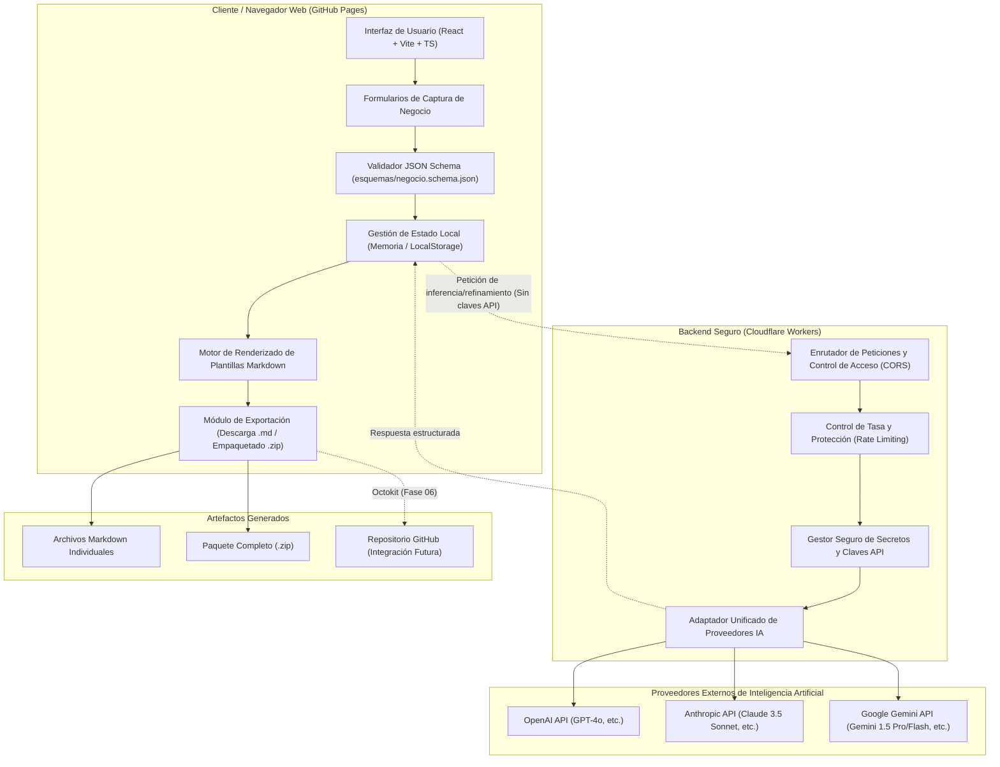

# 01. Arquitectura del Sistema — ContextStudio IA

---

## 1. Resumen Arquitectónico

ContextStudio IA se concibe bajo una arquitectura desacoplada y orientada a la seguridad (Jamstack / Serverless Proxy). El sistema separa estrictamente la capa de presentación e interacción del usuario de la capa de cómputo seguro y conexión con proveedores externos de Inteligencia Artificial.

> [!NOTE]
> La arquitectura descrita en este documento representa el diseño propuesto y aprobado para la Fase 01. Los detalles de implementación de bajo nivel se refinarán en las fases técnicas correspondientes (Fases 02, 03 y 04) según el [Roadmap](../docs/ROADMAP.md).

---

## 2. Pila Tecnológica Seleccionada

| Capa / Componente | Tecnología | Propósito |
| :--- | :--- | :--- |
| **Frontend Framework** | **React** (v18+) + **TypeScript** | Interfaz de usuario reactiva, tipada y modular. |
| **Herramienta de Construcción** | **Vite** | Empaquetado de alto rendimiento, desarrollo rápido y soporte SPA. |
| **Diseño y Estilos** | **Tailwind CSS** | Sistema de diseño basado en utilidades, consistente y responsivo. |
| **Alojamiento Frontend** | **GitHub Pages** | Hosting de activos estáticos con entrega global de bajo costo y alta disponibilidad. |
| **Backend / API Proxy** | **Cloudflare Workers** (Serverless) | Edge runtime ultraligero para intermediación segura de llamadas API a proveedores de IA sin exponer credenciales. |
| **Validación de Datos** | **JSON Schema (Draft 2020-12)** | Validación estricta de estructura y tipos de entrada del negocio. |
| **Motor de Plantillas** | Motor TypeScript nativo / Mustache-like | Sustitución determinista de variables e inyección de contexto. |
| **Empaquetado y Exportación** | **JSZip** + **FileSaver** | Generación y descarga en cliente de archivos Markdown individuales y paquetes `.zip`. |
| **Proveedores de IA** | **OpenAI**, **Anthropic (Claude)**, **Google (Gemini)** | Modelos de lenguaje para refinamiento, redacción creativa y síntesis. |
| **Integración Futura** | **GitHub REST API / Octokit** | Creación y sincronización de repositorios directos en cuentas de usuario. |

---

## 3. Diagrama de Arquitectura General

---

## 4. Responsabilidades de los Componentes

### 4.1. Capa Frontend (React + TypeScript + Vite)
- **Captura estructurada de datos:** Presenta formularios paso a paso accesibles e intuitivos para recopilar información empresarial (identidad, contactos, productos, público, metas).
- **Validación del lado del cliente:** Ejecuta la validación contra el esquema oficial `negocio.schema.json` antes de procesar o enviar datos.
- **Configuración de módulos:** Permite al usuario activar o desactivar generadores específicos según su necesidad.
- **Previsualización de documentos:** Renderiza vistas previas en tiempo real con resaltado de sintaxis Markdown.
- **Seguridad estricta en el cliente:** No almacena ni gestiona claves API de producción de proveedores de IA en el código cliente desplegado en GitHub Pages.

### 4.2. Capa Backend (Cloudflare Workers)
- **Aislamiento de credenciales:** Almacena y gestiona de forma hermética las claves de acceso de OpenAI, Anthropic y Google Gemini mediante variables de entorno encriptadas (`wrangler secret`).
- **Proxy inverso seguro:** Recibe peticiones desde el frontend previamente autenticado o autorizado mediante políticas de CORS y tokens de sesión.
- **Unificación de interfaces (Adapter Pattern):** Normaliza las diferencias en los esquemas de petición y respuesta de los distintos proveedores de IA en un formato homogéneo consumible por el frontend.
- **Resiliencia y control de costos:** Implementa límites de tasa (rate limiting), timeouts y manejo unificado de errores ante caídas de proveedores.

### 4.3. Motor de Plantillas
- **Procesamiento declarativo:** Toma la estructura de datos validada del negocio y sustituye variables estandarizadas (`{{variable}}`) en las plantillas Markdown correspondientes.
- **Ensamblaje condicional:** Construye los documentos de salida integrando únicamente los bloques de contenido y generadores solicitados por el usuario.
- **Trazabilidad y referencias cruzadas:** Asegura que los archivos generados mantengan enlaces relativos coherentes hacia los documentos del núcleo empresarial.

### 4.4. Sistema de Exportación
- **Generación en memoria:** Compila en el navegador los contenidos generados en árboles de directorios virtuales.
- **Compresión y entrega:** Genera un archivo binario `.zip` listo para descargar o descarga individual de documentos `.md` sin requerir procesamiento adicional en servidor.

---

## 5. Política de Seguridad y Despliegue en GitHub Pages

> [!WARNING]
> **Prohibición de exposición de credenciales:**
> El despliegue en GitHub Pages distribuye código estático y paquetes JavaScript que se ejecutan en su totalidad en el navegador del usuario final. **Bajo ninguna circunstancia** deben incluirse claves de API de IA (`OPENAI_API_KEY`, `ANTHROPIC_API_KEY`, `GEMINI_API_KEY`) en el repositorio, en variables de entorno de Vite embebidas en el bundle (`VITE_*`) o en el código fuente del frontend.
> Todas las comunicaciones con proveedores de IA deberán canalizarse a través del backend en Cloudflare Workers o, en modalidad de desarrollo local, mediante variables de entorno resguardadas no versionadas en `.env.local`.
